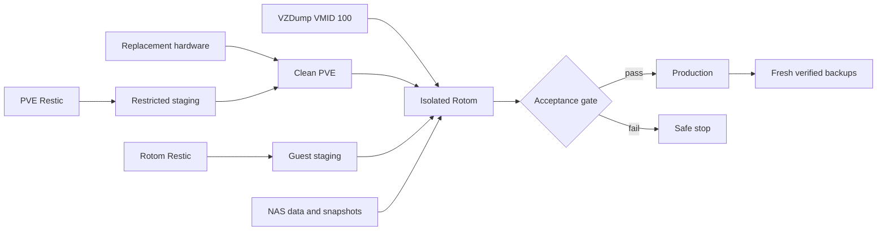
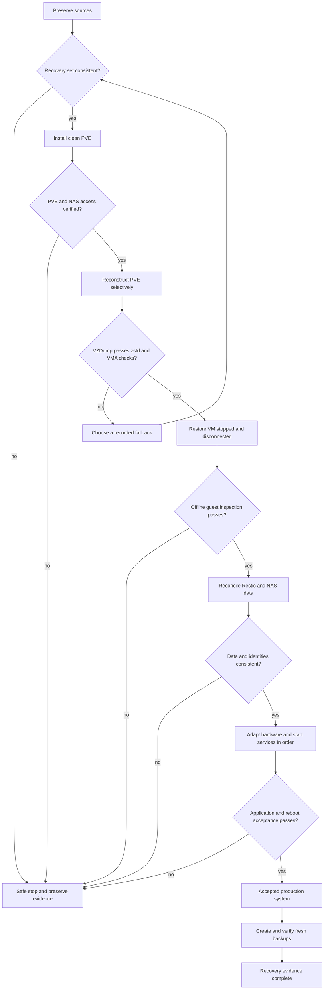
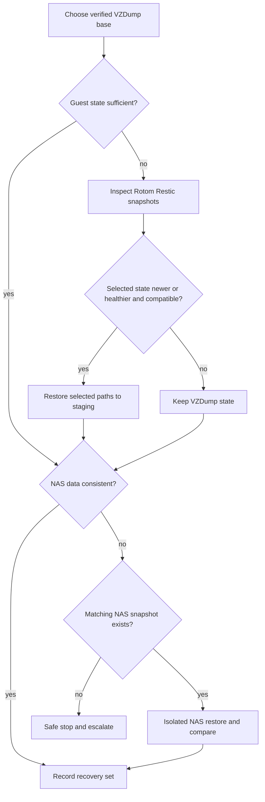
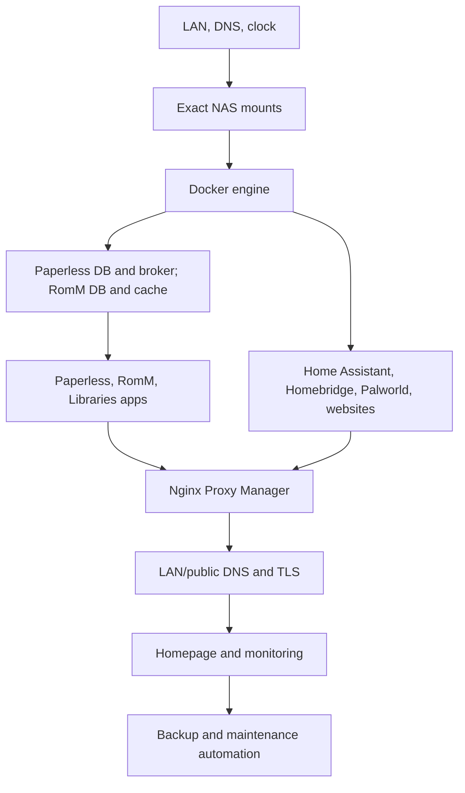

# PVE and Rotom Total-Loss Recovery

**Artifact class:** Supplementary repository guide; not a Rotom Support or Available Sources member
**Document role:** Orchestration guide for rebuilding PVE and Rotom after complete loss of the original computer
**Scenario:** Replacement hardware; original PVE installation, local disks, and running Rotom VM are unavailable
**Evidence baseline:** PVE and Rotom read-only inspection on 2026-10-16
**Documentation updated:** 2026-10-16 — Harden emergency execution and evidence controls
**Routine backup authority:** [05 - Backup and Restore](../runbook/05-Backup-and-Restore.md)
**RS index:** [01 - Rotom Server Inventory](../runbook/01-Rotom-Server-Inventory.md)
**RS dependency governance:** [00 - Rotom Change Log](../runbook/00-Rotom-Change-Log.md#current-documentation-maintenance-rules)

This supplementary guide provides **total-loss recovery orchestration** without becoming part of the RS. RS document 05 retains ownership of backup architecture, schedules, retention, assurance levels, routine checks, and ordinary restores; the other numbered RS documents retain their existing subject ownership. Commands in this guide are examples only where their syntax and current Rotom context were verified. Every selected snapshot, archive, device, interface, storage target, and recovery point must still be recorded and checked at incident time.

## Emergency Recovery Path

### Recovery order

```text
replacement hardware
-> clean PVE installation
-> minimal network and NAS access
-> selective PVE reconstruction
-> isolated VZDump restoration
-> Rotom inspection
-> selective Rotom Restic recovery
-> NAS data recovery
-> production activation
-> acceptance testing
-> fresh verified backups
```

### Required sources and first checks

| Source | Required role | First check | Never assume |
|---|---|---|---|
| PVE Restic Backup | Selected PVE configuration and reconstruction evidence | Confirm repository identity, snapshot time, and staged file list | It is not a host image and does not contain VM disks or complete PVE private state |
| Rotom VM Backup | Base restoration of VMID `100` | Confirm exact archive, size, timestamp, zstd integrity, and VMA integrity | A listing or decompression test alone proves restorability |
| Rotom Restic Backup | Selective guest-local recovery | Confirm repository identity, snapshot time, paths, and consistency with the VZDump | The newest snapshot should be overlaid wholesale |
| NAS data and snapshots | Authoritative `/mnt` payload | Confirm exact export, snapshot time, and isolated restore evidence | A directory at a mountpoint is the NAS filesystem |
| Historical raw image | Last-resort evidence and extraction source | Confirm exact image, size, SHA-256, and incident need | It is a normal or current restoration path |

Current addresses and paths to verify before use:

| Item | Recorded starting fact |
|---|---|
| PVE | `192.168.1.68` |
| Rotom | `192.168.1.69`, VMID `100`, recorded MAC `BC:24:11:97:10:47` |
| NAS | `192.168.1.70` |
| PVE Restic | `/mnt/nas-pve-restic-backup/pve-restic-backup` |
| PVE Restic staging | `/var/backups/pve-restic-recovery` |
| Rotom VM Backup | storage `nas-rotom-vm-backup`, `/mnt/pve/nas-rotom-vm-backup` |
| Rotom Restic | `/mnt/nas-rotom-restic-backup/rotom-restic-backup` |

### Critical stop conditions

Stop and preserve evidence when any of these is true:

- a required credential is unavailable;
- a source identity, export, repository, archive, VMID, path, or timestamp is ambiguous;
- a Restic repository has an unexplained lock, missing pack, corruption report, or active writer;
- the intended target contains irreplaceable data;
- the old VM or old PVE host could still return;
- VMID `100`, `192.168.1.68`, `192.168.1.69`, the recorded MAC, a hostname, DNS record, or storage ID conflicts;
- the NAS mount is absent, read-only unexpectedly, or points to a different export;
- local files may exist beneath an inactive mountpoint;
- recovery would require guessing a UID/GID, ACL, database/file pairing, private key, device mapping, or passthrough group;
- a command would write directly into `/etc/pve`, prune/repair/unlock Restic, alter NAS snapshots, or delete an original source without separate review and authorization.

### Isolation and activation gate

Restore VMID `100` with **Start after restore disabled**, immediately set `onboot=0`, and keep its virtual NIC disconnected. Boot only after reviewing the restored VM configuration and removing or adapting unavailable hardware. Before any temporary LAN access, stop Docker and other application writers inside the guest and use a temporary non-production identity. Production activation requires all of the following:

- the original system is proven unable to return;
- the chosen recovery points and consistency decision are recorded;
- VMID, MAC, IP, hostname, DNS, storage, and proxy conflicts are absent;
- exact NAS exports and numeric ownership are verified;
- database and file sets are mutually consistent;
- hardware-specific dependencies have passed or have an accepted degraded mode;
- the final acceptance table in [Phase 19](#phase-19---final-reboot-and-acceptance) is complete.

Credentials and private material are deliberately excluded from this guide. The offline recovery kit must identify approved retrieval locations for Restic passwords, NAS/router access, SSH private keys, DNS/domain access, application recovery keys, and any PVE private material that backups exclude.

Detailed phases: [0](#phase-0---declare-the-incident-and-preserve-recovery-sources), [1](#phase-1---inventory-snapshots-archives-nas-data-and-timestamps), [2](#phase-2---install-proxmox-ve), [3](#phase-3---establish-minimal-conflict-free-networking), [4](#phase-4---validate-pve-restic), [5](#phase-5---selectively-reconstruct-pve), [6](#phase-6---configure-rotom-vm-backup-storage), [7](#phase-7---verify-the-chosen-vzdump-archive), [8](#phase-8---restore-vmid-100-in-isolation), [9](#phase-9---inspect-rotom-before-activation), [10](#phase-10---verify-exact-nas-exports), [11](#phase-11---compare-vzdump-state-with-rotom-restic), [12](#phase-12---selectively-restore-guest-local-state), [13](#phase-13---recover-nas-resident-data), [14](#phase-14---validate-identities-and-permissions), [15](#phase-15---adapt-hardware-specific-configuration), [16](#phase-16---return-services-in-dependency-order), [17](#phase-17---validate-databases-applications-proxying-dns-and-tls), [18](#phase-18---restore-backup-and-maintenance-automation), [19](#phase-19---final-reboot-and-acceptance), and [20](#phase-20---create-and-verify-fresh-backups).

## Operator Navigation and Incident Control

Use the phases in order. A link is navigation, not permission to skip a gate. Keep the recovery record on a separate trusted device or on paper so it survives a failed replacement host.

| Need | Go directly to |
|---|---|
| First 15 minutes | [Emergency Recovery Path](#emergency-recovery-path), then [Phase 0](#phase-0---declare-the-incident-and-preserve-recovery-sources) |
| Choose a consistent recovery point | [Recovery-Point Selection and Consistency](#7-recovery-point-selection-and-consistency) |
| Record the current decision and loss window | [Recovery Control Sheet](#recovery-control-sheet) |
| Check whether the next phase is allowed | [Phase Gate Summary](#phase-gate-summary) |
| Handle a missing or failed source | [Troubleshooting and Fallback Paths](#30-troubleshooting-and-fallback-paths) |
| Stop or undo the last targeted change | [Rollback and Safe-Stop Matrix](#31-rollback-and-safe-stop-matrix) |
| Record proof | [Evidence Log](#32-evidence-log) |
| Close readiness gaps before a disaster | [Gap-Closure Register](#gap-closure-register) |
| Perform final acceptance | [Phase 19](#phase-19---final-reboot-and-acceptance) and [Printable Final Checklist](#34-printable-final-checklist) |

### Recovery state model

| State | Meaning | Permitted progression |
|---|---|---|
| `PRESERVED` | Sources inventoried and protected; no target recovery begun | Select a recovery set |
| `RECONSTRUCTING` | Clean PVE is being rebuilt; no restored production identity is active | Restore the VM stopped and disconnected |
| `ISOLATED` | Rotom may boot only through console; production MAC/IP and writers remain inactive | Inspect, stage, and reconcile |
| `RECOVERY-NETWORK` | Temporary conflict-free identity permits only required administrative/NAS access | Verify exact sources and dependencies |
| `PRODUCTION-CANDIDATE` | Production identity is enabled, but acceptance is incomplete | Run ordered service and reboot acceptance |
| `ACCEPTED` | Every Phase 19 row passes and residual risks are approved | Create the fresh backup baseline |
| `SAFE-STOP` | A gate failed or evidence is ambiguous | Preserve evidence; follow the owning fallback before proceeding |

### Recovery Control Sheet

| Control | Recorded value |
|---|---|
| Incident ID, date/time, and operator |  |
| Original host fencing proof |  |
| Replacement hardware identifier |  |
| Current recovery state | `PRESERVED` / `RECONSTRUCTING` / `ISOLATED` / `RECOVERY-NETWORK` / `PRODUCTION-CANDIDATE` / `ACCEPTED` / `SAFE-STOP` |
| PVE Restic snapshot ID/time |  |
| VZDump path/time/size/integrity evidence |  |
| Rotom Restic snapshot ID/time |  |
| NAS data or snapshot ID/time |  |
| Application DB/export time |  |
| Chosen consistency point and timezone |  |
| Expected loss window |  |
| Temporary PVE/Rotom identity |  |
| Approved production MAC/IP reuse |  |
| Current phase and gate evidence |  |
| Accepted degraded capabilities |  |
| Next action, owner, and approval |  |

## 1. Purpose, Audience, Scope, and Exclusions

This guide is for an administrator rebuilding Rotom without the original computer. It covers blank replacement hardware through accepted production service and new backups.

It does not authorize or prescribe:

- modifying the surviving NAS, repositories, snapshots, archives, credentials, DNS, or external services during preparation;
- blindly restoring an old PVE `/etc` tree or copying files directly into pmxcfs at `/etc/pve`;
- recreating retired Rotom services, mounts, accounts, networks, or paths;
- `restic unlock`, `repair`, `forget`, or `prune` outside the installed, separately authorized backup policy;
- manual edits to Restic repository internals;
- destructive replacement of any target before its identity and recoverability are established.

The official references supporting the procedure are the [Proxmox VE Administration Guide](https://pve.proxmox.com/pve-docs/pve-admin-guide.pdf), [Proxmox storage manager reference](https://pve.proxmox.com/pve-docs/pvesm.1.html), [pmxcfs documentation](https://pve.proxmox.com/pve-docs/chapter-pmxcfs.html), [Debian installation guide](https://www.debian.org/releases/stable/amd64/), [Restic repository checks](https://restic.readthedocs.io/en/stable/045_working_with_repos.html), and [Restic restore documentation](https://restic.readthedocs.io/en/stable/050_restore.html).

## 2. Scenario and Surviving Components

The original PVE host, local disks, firmware state, and running VM are gone. The UniFi NAS survives with the four current recovery domains plus NAS snapshots. Replacement disks, NIC names, MACs, CPU flags, firmware, GPU, IOMMU groups, USB topology, and boot layout may differ.

### Recovery architecture



### End-to-end flow with verification and safe-stop branches



## 3. Prepare-Now Readiness Checklist

Complete this while the current systems still exist. A missing required item is **CRITICAL PRE-DISASTER GAP**.

- [ ] Keep an offline, printable copy of the complete RS and this guide.
- [ ] Keep a verified PVE installer compatible with the protected system; current evidence is PVE `9.2.0`, manager `9.2.21`, kernel `7.0.14-19-pve`.
- [ ] Record installer checksum verification and boot mode.
- [ ] Store approved retrieval locations for both Restic passwords outside PVE and Rotom.
- [ ] Store NAS and UniFi/router administrator access outside the destroyed host.
- [ ] Store required SSH private keys securely outside the destroyed host; retain public authorization data separately.
- [ ] Record DNS/domain registrar and Cloudflare access recovery.
- [ ] Record application encryption/recovery keys and certificate-account recovery where applicable.
- [ ] Export or print the current PVE network, storage, backup-job, and VMID `100` configuration without secrets.
- [ ] Record PVE/Rotom/NAS IP reservations and the decision on reusing the Rotom MAC.
- [ ] Record ConBee II `1cf1:0030`, Intel Bluetooth `8087:0aaa`, iGPU `8086:3ea5`, device purpose, physical port, and acceptance test.
- [ ] Record current NAS export discovery and snapshot policy, including isolated restore steps.
- [ ] Rehearse VZDump verification/isolated restore, Rotom Restic staging restore, PVE Restic staging restore, NAS snapshot restore, and application acceptance.
- [ ] Keep evidence from a full data-read Restic check separate from ordinary successful backup logs.

## 4. Offline Recovery Kit

| Item | Recorded locator — never the secret | Last verified | Gap rule |
|---|---|---|---|
| Verified PVE installer and compatible version |  |  | **CRITICAL PRE-DISASTER GAP** if absent |
| PVE Restic password |  |  | Password manager/emergency escrow location only |
| Rotom Restic password |  |  | Password manager/emergency escrow location only |
| NAS and router/UniFi administration |  |  | **CRITICAL PRE-DISASTER GAP** if host-dependent |
| SSH access |  |  | Secure private-key location plus public-key authorization record |
| RS and this guide |  |  | Include all numbered sources and an offline printable copy |
| NAS export discovery |  |  | Sanitized export/path record and appliance procedure |
| IP/MAC decisions |  |  | Prove old identities cannot return |
| DNS/domain access |  |  | Registrar/DNS provider recovery location plus MFA recovery |
| Application keys |  |  | Include encryption and recovery-key locators per application |
| USB/passthrough inventory |  |  | Device IDs, purpose, physical port, and photographs; bus numbers are not portable |

## 5. Recovery Architecture and Source Hierarchy

| Data category | Primary authority | Secondary recovery source | Rule |
|---|---|---|---|
| PVE installation and packages | Clean supported PVE install | PVE Restic inventory/package evidence | Recreate; do not overlay old `/etc` |
| PVE network and storage | New hardware plus reviewed PVE evidence | PVE Restic staged files | Recreate selectively |
| pmxcfs configuration | Fresh PVE APIs/UI and reviewed evidence | Staged `/etc/pve` public/config files | Inspect; never bulk-copy into `/etc/pve` |
| Rotom VM disks and base guest state | Selected VZDump archive | Historical raw image only if VZDump unavailable | VZDump is the normal base |
| Newer/healthier guest-local state | Selected Rotom Restic snapshot | VZDump state | Restore selected paths through staging |
| Libraries and Paperless media | Current NAS data or selected NAS snapshot | Historical artifacts where verified | Rotom Restic excludes `/mnt` |
| Guest identities and modes | Restored VM plus RS numeric contracts | Rotom Restic metadata | Never normalize recursively |
| Hardware passthrough | Replacement hardware evidence | Old config as intent only | Reassess; identifiers are not portable |

## 6. Hardware and PVE-Version Compatibility

| Area | Recorded old-host state | Replacement decision and gate |
|---|---|---|
| PVE | `9.2.0`; Debian 13; kernel `7.0.14-19-pve` | Prefer the same supported major and confirm the chosen archive restores before upgrading |
| Boot/storage | UEFI; one 250 GB NVMe; LVM-thin `local-lvm` | New target must hold the 100 GB guest plus safe free space; layout may differ |
| CPU | VM model `x86-64-v2-AES`, 8 vCPU | Confirm replacement CPU supports the selected model; reduce portability risk before first boot if needed |
| Memory | VM 12 GiB, balloon disabled | Provide at least the VM allocation plus host margin |
| NIC | old physical `nic0`, bridge `vmbr0`, static `192.168.1.68` | Discover the new NIC; do not copy the old interface name blindly |
| WOL/offloads | WOL enabled; TSO/GSO disabled on old `nic0` | Re-test driver support and need; do not replay automatically |
| iGPU | old PCI `00:02.0`, `8086:3ea5`, vfio-pci | New PCI address/group/device may differ; boot safely without it if uncertain |
| IOMMU | Intel IOMMU enabled; iGPU isolated in group 0 | Re-enumerate every group and verify firmware/IOMMU policy |
| USB | ConBee `1cf1:0030`; Bluetooth `8087:0aaa` | Prefer stable vendor/product mapping only after proving the exact device and exclusivity |
| VM firmware | OVMF, q35, 4 MiB EFI disk | Preserve when supported; do not convert firmware casually |

### Command and version provenance

| Interface | Evidence used for this guide | Incident-time rule |
|---|---|---|
| PVE and QEMU | PVE `9.2.0`, manager `9.2.21`, `qemu-server` `9.2.10`; local `qmrestore help` and current VM configuration captured 2026-10-16 | Re-read local help on the replacement version before using a changed option |
| VMA | Installed `vma help` confirmed stdin verification syntax on 2026-10-16 | Do not restore an archive unless both the zstd stream and VMA verify successfully |
| PVE storage | Current `pvesm status`, storage definition, and archive listing supplied 2026-10-16 | Reconfirm the exact export and storage ID on the replacement host |
| Restic | Official snapshot, check, and staging-restore documentation plus current repository layout | Stop if the replacement Restic CLI changes syntax or repository compatibility |
| Debian guest | Debian 13 current-state evidence and official stable installation guidance | Reconcile package/service behavior against the restored guest version |

These are compatibility evidence, not permission to replay old hardware configuration. Record replacement versions in the Evidence Log before the first state-changing command.

## 7. Recovery-Point Selection and Consistency

Do not combine the newest object from every layer automatically. Record a single decision before restore.

| Layer | Identifier | Timestamp and zone | Integrity evidence | Application relationship |
|---|---|---|---|---|
| PVE Restic |  |  |  | Host evidence only |
| VZDump |  |  |  | Base VM point |
| Rotom Restic |  |  |  | Guest-local point |
| NAS snapshot/data |  |  |  | `/mnt` authority |
| Application DB/export |  |  |  | Must match related files |
| Clock evidence |  |  | NTP/RTC/timezone | Normalize to `America/Los_Angeles` and UTC |

Decision rules:

- **Rotom Restic newer than VZDump:** inspect changed guest paths and application transaction boundaries; restore only a compatible selected set.
- **VZDump newer than Rotom Restic:** use VZDump state unless an older Restic copy is deliberately chosen to escape corruption or application damage.
- **NAS files newer than their guest database:** stop. Do not attach newer mutable files to an older catalog/database without an application-specific reconciliation plan.
- **Database and files from incompatible points:** recover both from one consistent point or use an application-native import/rebuild procedure.
- **No mutually consistent set:** preserve all sources, choose the least-loss isolated base, document expected loss, and escalate before production activation.

### Recovery-source decision tree



## 8. Global Stop Conditions

The Emergency Recovery Path stop conditions apply to every phase. In addition, stop on a changed command interface, unsupported PVE/Restic version, unexplained clock skew, incomplete evidence log, unexpected writer, capacity shortage, incomplete source checksum, failed application-native check, or any pressure to make an original recovery source writable merely for convenience.

## Phase 0 - Declare the Incident and Preserve Recovery Sources

| Control | Requirement |
|---|---|
| Outcome | Incident scope, authority, and surviving sources are recorded; originals remain unchanged |
| Entry | Total loss is confirmed; NAS is available or can be kept safely offline |
| Exclusions/impact | No recovery source, snapshot, repository, archive, credential, DNS, or external service changes |
| Source | NAS appliance inventory, offline RS, credential escrow |
| Read-only preflight | Record incident time, failed-host identity, NAS health, snapshot inventory, and who has write access |
| Stop | Old host may return; NAS degradation is active; source ownership is unclear |
| Smallest action | Freeze retention/deletion by approved appliance policy only if already rehearsed; otherwise preserve and escalate |
| Expected/verification | Every source has an owner, path, access mode, and preservation decision |
| Safe stop/troubleshooting | Disconnect replacement work from sources until ambiguity is resolved |
| Evidence/gate | Incident log and source register; do not continue until original sources are protected |

## Phase 1 - Inventory Snapshots, Archives, NAS Data, and Timestamps

**Read-only; may activate an existing automount**

```bash
date --iso-8601=seconds
timedatectl
sudo /usr/sbin/pvesm status
sudo /usr/sbin/pvesm list nas-rotom-vm-backup --content backup --vmid 100
```

| Control | Requirement |
|---|---|
| Outcome | A recovery-point table is complete without changing a source |
| Entry/source | Minimal PVE can read the backup storage; NAS snapshot view is available |
| Exclusions | Do not select by newest timestamp alone; do not browse protected file contents unnecessarily |
| Preflight | Confirm timezone, NTP, repository/export identity, archive sizes, and capacity |
| Stop | Clock skew, duplicate names, missing archive, unexpected export, or inconsistent snapshot lineage |
| Action | Record identifiers, hosts, timestamps, sizes, checksums where available, and application dependencies |
| Expected/verification | One explicit candidate set plus alternatives and loss window |
| Safe stop | Preserve the inventory and obtain missing appliance/application evidence |
| Evidence/gate | Signed recovery-point decision; do not continue until consistency is decided |

## Phase 2 - Install Proxmox VE

Use a verified official installer and the [Proxmox installation guidance](https://pve.proxmox.com/pve-docs/pve-admin-guide.pdf). The installer is destructive to selected destination disks.

| Control | Requirement |
|---|---|
| Outcome | Clean, supported, patched PVE with no imported old configuration |
| Entry | Installer hash/version, target disk, firmware mode, and console access verified |
| Exclusions/authority/impact | **Destructive — explicit approval required** for target-disk installation; do not attach recovery-source disks as install targets |
| Source | Verified installer and offline hardware record, not PVE Restic `/etc` |
| Preflight | Confirm serial/model/capacity of exact target; disconnect unnecessary disks; record firmware settings |
| Stop | Target ambiguity, failing storage/RAM, unsupported NIC/storage, or installer/version uncertainty |
| Smallest action | Install PVE on the selected blank target using the intended hostname and temporary conflict-free network |
| Expected | PVE boots locally, time is correct, root storage is healthy, and UI/SSH is reachable only as intended |
| Verification | `pveversion -v`, `timedatectl`, `lsblk`, `pvesm status`, package/repository review |
| Rollback/safe stop | Reinstall only on the verified blank target; never overwrite a surviving source |
| Troubleshooting | Use installer terminal/debug mode for driver issues; obtain compatible firmware rather than guessing |
| Evidence/gate | Installer version/hash, disk map, boot mode, package versions; do not continue until clean PVE is stable |

## Phase 3 - Establish Minimal Conflict-Free Networking

The old host used PVE `192.168.1.68`, Rotom `192.168.1.69`, NAS `192.168.1.70`, gateway `192.168.1.1`, bridge `vmbr0`, and physical interface `nic0`. Only the addresses are recovery contracts; the interface name and offload hooks are old-hardware evidence.

| Control | Requirement |
|---|---|
| Outcome | Replacement PVE reaches the NAS and administration station without identity collision |
| Entry | New NIC name/MAC/link and router reservations inspected |
| Exclusions/impact | **PVE — Jared executes**; no WAN, DNS, forwarding, or unrelated VLAN change |
| Source | New hardware enumeration plus recorded address plan |
| Preflight | Prove old PVE/VM cannot return; inspect `ip -brief link`, routes, reservations, and switch port |
| Stop | Duplicate address/MAC/hostname, unclear bridge port, or NAS reachable through an unexpected path |
| Smallest action | Create/adapt one management bridge for the new NIC; use a temporary address until identity reuse is approved |
| Expected | PVE-to-NAS and admin-to-PVE connectivity works; Rotom identity is still absent |
| Verification | `ip -brief address`, `ip route`, `ping`/NAS access from intended LAN, no duplicate-address alert |
| Rollback/safe stop | Use local console to revert only the new network definition |
| Troubleshooting | If NIC name/driver differs, update the bridge port; do not rename blindly to `nic0` |
| Evidence/gate | New NIC/bridge/MAC/address record; do not continue until conflict-free NAS access is proven |

## Phase 4 - Validate PVE Restic

PVE Restic currently uses `/mnt/nas-pve-restic-backup/pve-restic-backup`, stages at `/var/backups/pve-restic-recovery`, and holds selected files plus inventories. Current staging included network/boot/package configuration, PVE public/config files, VM configuration evidence, local scripts/units, and `RESTORE-NOTES.txt`; it did not contain VM disks, VZDump archives, the Restic password, SSH private keys, `/var/lib/pve-cluster/config.db`, or the private contents of `/etc/pve/priv`.

**Credential-sensitive**
**PVE — Jared executes**

```bash
sudo install -d -o root -g root -m 0700 /var/backups/pve-restic-recovery
sudo env \
  RESTIC_REPOSITORY=/mnt/nas-pve-restic-backup/pve-restic-backup \
  RESTIC_PASSWORD_FILE=/etc/restic/restic-repository-password \
  restic snapshots --host pve
```

| Control | Requirement |
|---|---|
| Outcome | Repository identity and chosen snapshot are readable; no live configuration is overwritten |
| Entry/source | Exact NFS export mounted; externally retrieved password installed root-only at the recorded path |
| Exclusions/impact | Listing is read-only; do not initialize, unlock, repair, forget, prune, or edit repository files |
| Preflight | Confirm no Restic writer, exact mount, root capacity, password-file metadata, and selected snapshot ID |
| Stop | Lock, active writer, repository mismatch, missing packs, corruption, or credential uncertainty |
| Action | List snapshots and files; perform `restic check` only as a separately scheduled assurance step |
| Expected/verification | Snapshot host/path/timestamp matches the recorded recovery set |
| Safe stop | Unmount only when no process uses it; preserve errors and source state |
| Evidence/gate | Repository ID if available, snapshot ID/time, listing and check result; do not continue until readable |

## Phase 5 - Selectively Reconstruct PVE

Restore PVE Restic to staging first. Restic warns that in-place restoration can leave partial state; this guide therefore forbids restoring it onto `/` or `/etc` directly.

**Credential-sensitive**
**PVE — Jared executes**

```bash
PVE_STAGE="$(sudo mktemp -d -p /var/backups/pve-restic-recovery total-loss.XXXXXXXX)"
sudo chmod 0700 "$PVE_STAGE"
read -r -p 'Exact selected PVE Restic snapshot ID: ' PVE_SNAPSHOT
sudo env \
  RESTIC_REPOSITORY=/mnt/nas-pve-restic-backup/pve-restic-backup \
  RESTIC_PASSWORD_FILE=/etc/restic/restic-repository-password \
  restic restore "$PVE_SNAPSHOT" --target "$PVE_STAGE"
```

The unique staging directory avoids overwriting an earlier recovery attempt. Record the printed value of `PVE_STAGE` in the evidence log.

| Classification | Examples from current staging | Treatment |
|---|---|---|
| Recreate | PVE network bridge, storage definition, backup job, users/roles, timers | Use current PVE UI/API or reviewed fresh files; verify each result |
| Restore selectively | Reviewed `/usr/local` workers, systemd units, non-secret SSH daemon settings | Compare with fresh versions; install one exact file at a time with recorded metadata |
| Inspect only | package inventory, block devices, `vm-100-config.txt`, `/etc/pve/{storage,jobs,user,datacenter}.cfg` | Evidence for reconstruction; do not copy into pmxcfs |
| Hardware-specific | GRUB/kernel arguments, modules, modprobe, interface hooks, EFI inventory | Recreate only after replacement-hardware validation |
| Unavailable/excluded | VM disks, VZDump data, Restic password, private SSH keys, `/etc/pve/priv` contents, pmxcfs database | Recover externally or recreate; never infer values |

| Control | Requirement |
|---|---|
| Outcome | Only portable, reviewed PVE behavior is rebuilt |
| Entry | Staged restore complete; clean PVE baseline and diffs retained |
| Exclusions/authority/impact | Never overwrite a fresh `/etc`; never copy directly into `/etc/pve`; every installed file is separately reviewed |
| Source | Selected staged snapshot plus current official PVE configuration interfaces |
| Preflight | Compare staged and fresh files, package versions, paths, owners, modes, hardware assumptions, and secret references |
| Stop | A file embeds old disks/NICs/keys, PVE syntax differs, or a private dependency is unavailable |
| Smallest action | Recreate network/storage/backup via supported interfaces; install only reviewed scripts/units |
| Expected | PVE remains bootable after each small change |
| Verification | Reload/enable only intended units; verify PVE UI, storage, job listings, and `systemctl --failed` |
| Rollback/safe stop | Retain fresh-file copies and remove/revert only the last targeted change |
| Troubleshooting | Prefer clean recreation over copying an opaque old file |
| Evidence/gate | Diff, command result, owner/mode, unit result; do not continue until PVE is stable |

The Proxmox cluster filesystem is database-driven; follow the [pmxcfs recovery model](https://pve.proxmox.com/pve-docs/chapter-pmxcfs.html) only under a separately reviewed procedure. The total-loss normal path does **not** replace `config.db` or hand-copy staged files into `/etc/pve`.

## Phase 6 - Configure Rotom VM Backup Storage

Recorded storage contract:

```text
nfs: nas-rotom-vm-backup
        server 192.168.1.70
        export /volume/4d6b927b-3d90-4af3-9bd7-be668266998a/.srv/.unifi-drive/Rotom_VM_Backup/.data
        path /mnt/pve/nas-rotom-vm-backup
        content backup
```

| Control | Requirement |
|---|---|
| Outcome | PVE storage ID resolves to the exact surviving NFS export |
| Entry | NAS/export reachable; no conflicting PVE storage ID |
| Exclusions/impact | **PVE — Jared executes**; do not edit UniFi-managed exports or NAS permissions |
| Preflight | Discover exports through approved NAS procedure; compare UUID-backed path and address |
| Stop | Export/path mismatch, unexpected contents, read-only/error state, or another cluster uses the same storage unsafely |
| Smallest action | Add the NFS storage with content type `backup` only |
| Expected/verification | `pvesm status` is active and `pvesm list ... --vmid 100` shows expected archives |
| Safe stop | Disable/remove only the PVE storage definition; do not delete NAS data |
| Troubleshooting | Resolve routing/export policy with NAS evidence; do not manufacture a local `dump` directory |
| Evidence/gate | Storage definition, exact mount source/options, archive listing; do not continue until exact-source proof passes |

## Phase 7 - Verify the Chosen VZDump Archive

As of 2026-10-16, eight archives existed from October 4 through October 16. Retention changes this set; never hard-code one of those files as the incident choice.

**Read-only; may activate an existing automount**
**PVE — Jared executes**

```bash
read -r -p 'Exact selected VMID 100 .vma.zst path: ' ARCHIVE
case "$ARCHIVE" in
  /mnt/pve/nas-rotom-vm-backup/dump/vzdump-qemu-100-*.vma.zst) ;;
  *) printf '%s\n' 'STOP: unexpected archive path' >&2; return 1 2>/dev/null || exit 1 ;;
esac
sudo test -f "$ARCHIVE"
sudo stat -c '%n %s bytes %y' "$ARCHIVE"
sudo zstd --test "$ARCHIVE"
set -o pipefail
sudo zstd --decompress --stdout --no-progress "$ARCHIVE" |
  sudo vma verify -v -
```

| Control | Requirement |
|---|---|
| Outcome | Both compressed stream and VMA contents verify for the selected archive |
| Entry/source | Recorded candidate archive and sufficient NAS/network stability |
| Exclusions | No repair, rename, recompression, or source write |
| Preflight | Confirm size, date, VMID, free working resources, and no concurrent NAS maintenance |
| Stop | Either pipeline stage fails, NFS errors occur, archive changes while read, or VM config is unexpected |
| Action | Run both checks with pipeline failure propagation and retain full output |
| Expected/verification | zstd success, VMA reaches 100%, pipeline exit zero |
| Safe stop | Keep the archive unchanged; test an older recorded candidate only after updating the decision log |
| Evidence/gate | Exact path, size, timestamp, checksums if available, both results; do not restore until both pass |

A successful verification proves only this archive stream. It does not prove guest boot, application consistency, NAS availability, or production readiness.

## Phase 8 - Restore VMID `100` in Isolation

**PVE — Jared executes**

```bash
sudo /usr/bin/pvesh get /cluster/resources --type vm --output-format yaml
sudo /usr/sbin/pvesm status
read -r -p 'Exact verified VMID 100 archive path: ' ARCHIVE
case "$ARCHIVE" in
  /mnt/pve/nas-rotom-vm-backup/dump/vzdump-qemu-100-*.vma.zst) ;;
  *) printf '%s\n' 'STOP: unexpected archive path' >&2; return 1 2>/dev/null || exit 1 ;;
esac
sudo test -f "$ARCHIVE"
sudo /usr/sbin/qmrestore "$ARCHIVE" 100 --storage local-lvm --start 0
sudo /usr/sbin/qm set 100 --onboot 0
sudo /usr/sbin/qm set 100 \
  --net0 virtio=BC:24:11:97:10:47,bridge=vmbr0,link_down=1
sudo /usr/sbin/qm config 100
sudo /usr/sbin/qm status 100
```

The network command applies only if the approved production MAC and bridge remain `BC:24:11:97:10:47` and `vmbr0`. Otherwise stop and record the replacement values; do not run it unchanged.

| Control | Requirement |
|---|---|
| Outcome | VMID `100` exists, stopped, `onboot=0`, NIC disconnected, disks restored to verified storage |
| Entry | VMID free, archive verified, capacity sufficient, original VM fenced permanently |
| Exclusions/impact | Restore writes local VM storage; never use `--force`; never use `--start 1` or live restore |
| Source | Exact verified VZDump archive |
| Preflight | Check VM inventory, storage free space, archive config, bridge, and old-host fencing |
| Stop | VMID exists, storage differs, passthrough is unresolved, or restore reports any error |
| Smallest action | Restore one VM, disable autostart, disconnect its only NIC |
| Expected/verification | `qm status 100` is stopped and config shows intended disks plus `link_down=1`, `onboot=0` |
| Rollback/safe stop | Leave stopped; do not destroy a partial VM until logs and target volumes are reviewed |
| Troubleshooting | Restore a different verified archive only after recording why and reassessing consistency |
| Evidence/gate | Restore task log and final config; do not boot until hardware-specific config is reviewed |

## Phase 9 - Inspect Rotom Before Activation

Before first boot, compare the restored configuration with the current contract: OVMF/q35, `x86-64-v2-AES`, 8 cores, 12 GiB, 100 GB SCSI disk, EFI disk, NIC, iGPU, ConBee, and Bluetooth. Remove unavailable passthrough through the PVE Hardware UI only after retaining the restored configuration. Do not map replacement devices by position alone.

**PVE — Jared executes**

```bash
sudo /usr/sbin/qm start 100
sudo /usr/sbin/qm status 100
```

Use the PVE console while the NIC remains disconnected.

**Read-only**

```bash
hostnamectl
uname -a
lsblk -o NAME,SIZE,FSTYPE,TYPE,MOUNTPOINTS
findmnt --fstab -t nfs,nfs4 -o TARGET,SOURCE,FSTYPE,OPTIONS
getent passwd platform libraries hosted-websites game-servers smart-home desktopcmd jared fran
getent group 5000 5001 5002 5003 5004 989
systemctl --failed --no-pager
sudo docker ps -a --format 'table {{.Names}}\t{{.Status}}'
```

| Control | Requirement |
|---|---|
| Outcome | Guest identity, filesystems, accounts, services, and restore timestamp are understood offline |
| Entry | VM boots with NIC disconnected and no unresolved host-device dependency |
| Exclusions | Do not start failed services, mount NAS, edit network identity, or normalize permissions |
| Stop | Wrong hostname/disk/layout, filesystem errors, missing identities, unexpected writers, or VM point mismatch |
| Action | Inspect only; stop Docker before temporary recovery networking |
| Expected/verification | Rotom boots to console and core local state matches the selected VZDump point |
| Safe stop | Shut down guest from console; retain QEMU and guest logs |
| Evidence/gate | Guest inventory and discrepancy list; do not connect networking until Docker/writers are stopped |

**Changes Rotom**

```bash
sudo systemctl disable --now docker.service docker.socket
sudo systemctl --failed --no-pager
```

Do not continue until application writers are stopped. Before temporary LAN access, assign a temporary MAC/IP through an approved isolated recovery design; do not expose production listeners or reuse `192.168.1.69` yet.

## Phase 10 - Verify Exact NAS Exports

| Guest target | Recorded NAS export role | Required content |
|---|---|---|
| `/mnt/nas-libraries` | `Libraries/.data` | `library/`, `torrents/`, `paperless/` and sentinel contract |
| `/mnt/nas-rotom-restic-backup` | `Rotom_Restic_Backup/.data` | `rotom-restic-backup/` |
| `/mnt/nas-game-servers` | `Game_Servers/.data` | Empty current service boundary |
| `/mnt/nas-smart-home` | `Smart_Home/.data` | Empty current service boundary |
| `/mnt/nas-hosted-websites` | `Hosted_Websites/.data` | Empty current service boundary |

**Read-only**

```bash
findmnt --fstab -t nfs,nfs4 -o TARGET,SOURCE,FSTYPE,OPTIONS
findmnt -rn -t nfs,nfs4 -o TARGET,SOURCE,FSTYPE,OPTIONS
systemctl list-units --type=automount --all --no-pager
```

| Control | Requirement |
|---|---|
| Outcome | Every needed mount resolves to its exact NFS source; no shadow directory is mistaken for data |
| Entry | Temporary recovery network permits NAS only; writers remain stopped |
| Exclusions/impact | Access may activate automounts; no writes, export edits, permission changes, or directory creation |
| Preflight | Compare fstab, live mount, NAS address, export UUID/name, NFS version/options, and ownership |
| Stop | `findmnt` shows only local/autofs when NFS is required, wrong export, missing directory, local shadow files, or unexpected mode |
| Action | Activate only the exact mount needed, using document 04; verify before listing data |
| Expected/verification | Exact NFSv3 source and documented required paths are present |
| Safe stop | Stop before mounting over local files; preserve both views for reconciliation |
| Evidence/gate | Configured and live source, options, required-path stats; do not continue until exact-source proof passes |

## Phase 11 - Compare VZDump State with Rotom Restic

**Credential-sensitive**

```bash
sudo env \
  RESTIC_REPOSITORY=/mnt/nas-rotom-restic-backup/rotom-restic-backup \
  RESTIC_PASSWORD_FILE=/etc/restic/restic-repository-password \
  restic snapshots --host rotom
read -r -p 'Exact selected Rotom Restic snapshot ID: ' ROTOM_SNAPSHOT
sudo env \
  RESTIC_REPOSITORY=/mnt/nas-rotom-restic-backup/rotom-restic-backup \
  RESTIC_PASSWORD_FILE=/etc/restic/restic-repository-password \
  restic ls "$ROTOM_SNAPSHOT"
```

| Rotom path category | Base/source rule |
|---|---|
| `/srv/rotom/stacks` | Compare declarative state; restore only reviewed differences |
| `/srv/rotom/appdata` | Restore application-consistent selected subtrees only |
| `/srv/rotom/secrets` | Recover only from protected verified source; never expose content |
| `/etc`, `/usr/local`, systemd | Compare exact files; do not overlay whole trees |
| `/var/lib/docker/volumes` | Treat as application data; prefer Compose-owned current paths and native DB procedures |
| `/home`, `/root`, `/opt` | Select by incident need and ownership contract |
| `/mnt/*` | Not in Rotom Restic; use NAS authority |

| Control | Requirement |
|---|---|
| Outcome | A path-level restore plan states why each VZDump path is kept or replaced |
| Entry | Selected VZDump is inspected; Restic repository/snapshot is readable |
| Exclusions | No restore, unlock, repair, retention, prune, or repository-internal edit |
| Preflight | Compare timestamps, application versions, DB/file boundaries, owners/modes, and VZDump point |
| Stop | No consistent pairing, missing credential, lock/corruption, unknown application schema, or snapshot ambiguity |
| Action | Record keep/restore/rebuild decision per path and application |
| Expected/verification | No wholesale overlay is planned; every selected path has an acceptance check |
| Safe stop | Keep VZDump state and preserve Restic as alternate evidence |
| Evidence/gate | Path comparison and consistency decision; do not restore until approved |

## Phase 12 - Selectively Restore Guest-Local State

**Changes Rotom**
**Credential-sensitive**

```bash
ROTOM_STAGE="$(sudo mktemp -d -p /var/backups rotom-total-loss.XXXXXXXX)"
sudo chmod 0700 "$ROTOM_STAGE"
read -r -p 'Exact selected Rotom Restic snapshot ID: ' ROTOM_SNAPSHOT
sudo env \
  RESTIC_REPOSITORY=/mnt/nas-rotom-restic-backup/rotom-restic-backup \
  RESTIC_PASSWORD_FILE=/etc/restic/restic-repository-password \
  restic restore "$ROTOM_SNAPSHOT" \
  --target "$ROTOM_STAGE"
```

This restores the selected snapshot only into restricted staging. If the full snapshot is too large, use Restic's verified `--include` or `SNAPSHOT:/subfolder` syntax from the official restore documentation and record the exact selection.

| Control | Requirement |
|---|---|
| Outcome | Selected files exist in staging and only reviewed application sets are promoted |
| Entry | Writers stopped; snapshot/path plan approved; staging capacity sufficient |
| Exclusions/impact | Never target `/`; do not use `--delete`; do not recursively rewrite ownership; do not mix DB/files from incompatible points |
| Source | Exact selected Rotom Restic snapshot |
| Preflight | Record live/restored metadata and hashes where useful; identify native DB shutdown/check/import method |
| Stop | Staging escapes its root, symlink/device is unexpected, metadata differs without explanation, or DB check fails |
| Smallest action | Restore to staging; compare; promote one stopped application-consistent set at a time |
| Expected | Staging mirrors selected paths with preserved metadata; production remains unchanged until promotion |
| Verification | File counts/hashes, numeric owners/modes/ACLs, SQLite `PRAGMA quick_check` where applicable, native DB readiness/dump checks after controlled start |
| Rollback/safe stop | Preserve pre-promotion copy or VZDump state; if promotion fails, stop the application and restore that exact prior set |
| Troubleshooting | Prefer application-native export/import when raw database compatibility is uncertain |
| Evidence/gate | Snapshot/path, diff, metadata, DB result, promotion record; do not continue until each selected set passes |

**NEEDS VERIFICATION BEFORE DISASTER:** record the exact current database file paths and tested application-native offline integrity/export commands for NPM, Home Assistant, Paperless PostgreSQL, and RomM MariaDB after every major application upgrade.

## Phase 13 - Recover NAS-Resident Data

| NAS category | Authority | Consistency requirement |
|---|---|---|
| Libraries media/games | Current NAS or selected NAS snapshot | Must match application catalogs where applicable |
| Torrents | Current NAS/snapshot | qBittorrent sentinel and save-path contract must pass |
| Paperless media | Current NAS/snapshot | Must match Paperless database/document records |
| Empty service boundaries | Current NAS export metadata | Do not populate from historical paths |
| Retired exports/raw image | Historical evidence only | Separate authorization and incident need |

| Control | Requirement |
|---|---|
| Outcome | Authoritative NAS data is mounted or restored from a recorded consistent point |
| Entry | Exact export/snapshot and application DB relationship established |
| Exclusions/authority/impact | **Changes Rotom and protected storage/repository state** when promoting NAS snapshot data; never hand-edit UniFi exports |
| Preflight | Use appliance-native isolated restore, record snapshot ID/time, compare manifests without writers |
| Stop | Snapshot unavailable, source damaged, target contains unique newer data, or files/DB are incompatible |
| Smallest action | Restore only the required NAS dataset/path through supported appliance workflow |
| Expected/verification | Exact export contains expected paths, counts/manifests, metadata, and application-consistent point |
| Rollback/safe stop | Keep isolated restore separate; do not promote until comparison passes |
| Troubleshooting | If snapshots are absent, preserve current data and escalate to application-specific reconciliation |
| Evidence/gate | Snapshot/export/path/manifests and promotion approval; do not continue until authority is resolved |

## Phase 14 - Validate Identities and Permissions

| Domain | Required UID:GID | Notes |
|---|---:|---|
| Platform | `997:5002` | Locked account; absent `/home/platform` |
| Libraries | `127:5000` | Locked; NAS numeric contract |
| Hosted Websites | `902:5004` | Locked; absent service home |
| Game Servers | `995:5001` | Locked; Palworld VM-local |
| Smart Home | `126:5003` | Locked; absent service home |
| Remote Desktop Commander | `1001:1001` | Locked; `/opt/desktop-commander` |

**Read-only**

```bash
getent passwd platform libraries hosted-websites game-servers smart-home desktopcmd jared fran
getent group 5000 5001 5002 5003 5004 989
sudo stat -c '%n %u:%g %a' /srv/rotom /srv/rotom/stacks /srv/rotom/appdata /srv/rotom/secrets /mnt/nas-libraries
```

| Control | Requirement |
|---|---|
| Outcome | Numeric identity, locked state, ownership, modes, ACLs, setgid, Docker privilege, and NFS access match current contracts |
| Entry | Guest/NAS state selected and writers stopped |
| Exclusions | No recursive `chown`, UID/GID renumbering, broad ACL, group expansion, home recreation, or `chmod 777` |
| Stop | Named/numeric mapping differs, ACL source is unknown, or NAS root appears mapped to an unrelated name |
| Action | Correct only an exact reviewed object after recording prior metadata |
| Expected/verification | Intended service positive access and unrelated-user negative access both behave as expected |
| Safe stop | Restore recorded metadata on the exact object; do not broaden permissions |
| Evidence/gate | Numeric metadata and access tests; do not start applications until passed |

## Phase 15 - Adapt Hardware-Specific Configuration

| Dependency | Old intent | Replacement reassessment |
|---|---|---|
| NIC/bridge | `nic0` -> `vmbr0`, WOL, TSO/GSO workaround | New name/driver/MAC; re-test WOL and offload behavior |
| CPU model | `x86-64-v2-AES` | Confirm supported flags and guest boot |
| iGPU | `hostpci0: 00:02.0,pcie=1` | New PCI ID/group/reset/ROM behavior; optional degraded boot without passthrough |
| ConBee II | `usb0`, `1cf1:0030`, guest `/dev/ttyACM0` | Re-identify device; path may change; preserve Zigbee network |
| Bluetooth | `usb1`, `8087:0aaa` | Re-identify and test controller/pairing |
| Firmware/IOMMU | `intel_iommu=on`; old grouping | New firmware flags and groups; never reuse group assumptions |
| Boot/storage | OVMF/q35, local LVM-thin | Confirm EFI, discard, SSD, and storage compatibility |

| Control | Requirement |
|---|---|
| Outcome | VM boots reliably with only proven replacement hardware mappings |
| Entry | Base guest passes offline checks; new hardware inventory complete |
| Exclusions/impact | **PVE — Jared executes**; no guessed passthrough or old kernel argument replay |
| Preflight | Enumerate PCI/USB/IOMMU, drivers, firmware, reset behavior, and VM config |
| Stop | Shared IOMMU group, missing reset support, ID ambiguity, host instability, or guest driver failure |
| Smallest action | Enable one dependency at a time; keep an accepted no-passthrough degraded mode available |
| Expected/verification | Host remains stable; guest sees intended device; dependent application passes |
| Rollback/safe stop | Disconnect only the last device mapping and boot without it |
| Troubleshooting | Treat the old option-ROM warning as evidence, not a diagnosis; inspect new logs |
| Evidence/gate | Before/after configs and host/guest/application tests; do not bundle mappings |

## Phase 16 - Return Services in Dependency Order

### Service dependency graph



| Order | Services | Gate |
|---:|---|---|
| 1 | Clock, LAN, resolver | Correct time/routes/resolution; no identity conflict |
| 2 | Exact NFS automounts | Exact source, required directories, metadata, no shadows |
| 3 | Docker engine | Clean daemon start; no blanket container recreation |
| 4 | Database/broker/cache tiers | Native readiness and configured health pass |
| 5 | Storage-dependent apps | NAS sentinel/binds and app health pass |
| 6 | VM-local apps/sites | Local state and device dependencies pass |
| 7 | NPM | Upstreams work directly before proxy checks |
| 8 | DNS/TLS/external paths | Intended routes only; private access lists preserved |
| 9 | Monitoring/automation | Read-only endpoints and timers reflect accepted state |

| Control | Requirement |
|---|---|
| Outcome | Services return one dependency layer at a time with failures contained |
| Entry | Identity/storage/hardware gates passed; production identity reuse approved |
| Exclusions/impact | **Changes Rotom**; no global Compose `down`, prune, image cleanup, or broad restart |
| Preflight | Render all Compose definitions; inspect desired state, mounts, secrets metadata, and restart policies |
| Stop | Missing mount/secret, unhealthy DB, unexpected recreation, or unapproved service appears |
| Smallest action | Enable/start Docker, then start one established Compose project/layer at a time |
| Expected/verification | Each layer passes before its consumers start |
| Rollback/safe stop | Stop only the failing project; preserve volumes, logs, and upstream layers |
| Troubleshooting | Follow documents 02-04 by failing domain; do not bypass NAS guards |
| Evidence/gate | Project, image, state, health, direct response; do not advance on partial success |

## Phase 17 - Validate Databases, Applications, Proxying, DNS, and TLS

**Read-only**

```bash
sudo docker ps --format 'table {{.Names}}\t{{.Status}}\t{{.Ports}}'
sudo docker inspect --format '{{.Name}} {{if .State.Health}}{{.State.Health.Status}}{{else}}no-healthcheck{{end}}' \
  homepage paperless romm-db arcane palworld-server-jared palworld-server-fran
curl -sS -o /dev/null -w 'homepage %{http_code}\n' -H 'Host: rotom.casa' http://127.0.0.1:3001/
curl -sS -o /dev/null -w 'aloha %{http_code}\n' http://127.0.0.1:7778/
curl -sS -o /dev/null -w 'jaredwines %{http_code}\n' http://127.0.0.1:7777/
getent ahostsv4 rotom.casa
curl -sS -o /dev/null -w 'local-sni %{http_code}\n' \
  --resolve rotom.casa:443:127.0.0.1 https://rotom.casa/
systemctl --failed --no-pager
```

| Area | Concrete acceptance |
|---|---|
| SQLite-backed state | Offline `PRAGMA quick_check` reports `ok` for every selected/restored SQLite DB |
| Paperless | DB/broker/application health pass; authenticated read of known documents; media references resolve |
| RomM | DB and application configured health pass; known library/game metadata and media resolve |
| Home Assistant | UI/auth works; retained entities/integrations load; ConBee present if enabled; no reset/migration performed |
| Homebridge | UI/auth and established bridges/plugins load without secret exposure |
| Palworld | Both configured health checks pass; known worlds/players/settings are present through approved test |
| Libraries apps | Direct listeners and known library paths pass; qBittorrent `wg0` and sentinel contract pass |
| Websites | Aloha and Jared Wines direct responses are `200` before proxy validation |
| NPM | Exact routes, access lists, certificates, and upstreams match document 03; no stale row is activated |
| DNS/TLS | Intended LAN/public resolution, certificate name/chain/expiry, SNI routing, and access policy pass separately |

| Control | Requirement |
|---|---|
| Outcome | Data integrity and every supported access layer are verified |
| Entry | Dependencies running in order; credentials available through approved use |
| Exclusions | No test data deletion, DNS/proxy broadening, certificate replacement, or database repair during diagnosis |
| Stop | Native check fails, authenticated state is missing, files/DB disagree, wrong route/certificate, or unexpected exposure |
| Action | Test direct app, local SNI, LAN DNS/access, then intended public path |
| Expected/verification | Each table row passes with time, vantage, and result recorded |
| Safe stop | Stop only affected writers/project; keep production activation incomplete |
| Evidence/gate | Sanitized native checks, health, response codes, DNS/cert evidence; do not accept on boot alone |

## Phase 18 - Restore Backup and Maintenance Automation

Recreate, do not blindly copy, the current automation contracts: PVE Restic `04:00`, VZDump `05:00`, Rotom Restic around `03:00`, PVE weekly maintenance Sunday `00:30`, Rotom weekly maintenance Sunday `01:15`, backup status APIs, NAS recovery helper, and qBittorrent mount guard.

| Control | Requirement |
|---|---|
| Outcome | Timers/jobs, workers, credentials, mounts, and status endpoints match accepted state without running an unintended backup yet |
| Entry | Applications accepted; exact repositories and external credentials available |
| Exclusions/impact | **Changes Rotom** and **PVE — Jared executes**; do not start backup writers in this phase |
| Preflight | Compare installed unit/job, worker, schedule, randomization, retention, mount, credential path, and concurrency lock |
| Stop | Repository mismatch, missing credential, active writer, old hardware command, or retention discrepancy |
| Smallest action | Install/recreate one automation, daemon-reload, enable its timer/job, verify next trigger |
| Expected/verification | Units/jobs are enabled as intended, inactive between runs, and status endpoints are read-only |
| Rollback/safe stop | Disable only the new timer/job; do not remove repository data |
| Troubleshooting | Follow documents 05/06; never retry deterministic repository errors repeatedly |
| Evidence/gate | Unit/job definitions, next run, credential metadata, mount source; do not create fresh backups until Phase 20 |

## Phase 19 - Final Reboot and Acceptance

| Acceptance item | Required result | Evidence reference | Operator/time |
|---|---|---|---|
| PVE boot/storage/network | Correct boot, bridge, address, storage, zero unexplained failures |  |  |
| VM safety | VMID `100`, intended `onboot`, MAC/IP uniqueness, old host fenced |  |  |
| Rotom boot/filesystem | Clean boot, expected disk, no filesystem error |  |  |
| NAS | Exact five contracts; active mounts only where needed; no shadow data |  |  |
| Identity | Numeric UID/GID, locks, modes, ACLs, Docker membership correct |  |  |
| Docker | Expected projects/containers only; health/restarts reviewed |  |  |
| Databases/apps | Phase 17 checks pass |  |  |
| Proxy/DNS/TLS | Intended direct, SNI, LAN/public, certificate and access-list results |  |  |
| Hardware | Accepted NIC/WOL, GPU, USB, Bluetooth, ConBee results or documented degraded mode |  |  |
| Automation | Correct timers/jobs and next runs; no unexpected writer |  |  |
| Observability | Homepage/status APIs and logs reflect accepted state |  |  |
| Recovery evidence | Recovery-point decision, commands, outputs, and residual risks retained |  |  |

| Control | Requirement |
|---|---|
| Outcome | One controlled PVE reboot proves the reconstructed system returns to the accepted state |
| Entry | All earlier phase gates complete; console and rollback evidence available |
| Exclusions/impact | **PVE — Jared executes**; no simultaneous upgrade or unrelated maintenance |
| Preflight | Record running state, mounts, timers, device mappings, and console access |
| Stop | Any acceptance row incomplete or old identity could return |
| Smallest action | Reboot PVE once; observe host, VM, NAS race handling, containers, devices, and routes |
| Expected/verification | Every acceptance row passes after reboot without manual broad recovery |
| Rollback/safe stop | If host unstable, keep VM stopped or remove last passthrough; if guest fails, keep production gate closed |
| Troubleshooting | Use owning RS document and retained before/after evidence |
| Evidence/gate | Completed table; do not create the new recovery baseline until accepted |

## Phase 20 - Create and Verify Fresh Backups

Run only after Phase 19 acceptance. These actions write protected repositories and invoke installed retention/prune policy.

**Changes Rotom and protected storage/repository state**

```bash
sudo systemctl start rotom-restic-backup.service
systemctl status rotom-restic-backup.service --no-pager
```

**PVE — Jared executes**
**Changes Rotom and protected storage/repository state**

```bash
sudo systemctl start pve-restic-backup.service
sudo systemctl start rotom-vm-vzdump-manual.service
systemctl status pve-restic-backup.service rotom-vm-vzdump-manual.service --no-pager
```

| Control | Requirement |
|---|---|
| Outcome | Fresh accepted-system PVE Restic, VZDump, Rotom Restic, and NAS snapshot recovery points exist and are tested |
| Entry | Final acceptance complete; no writer conflict; repositories healthy and exact mounts active |
| Exclusions/impact | No ad hoc retention change, manual prune, source deletion, or old-baseline retirement |
| Preflight | Check capacity, mounts, locks/processes, credentials, database prechecks, and installed policies |
| Stop | Any backup fails, prune incomplete, repository lock/corruption, archive missing, or NAS snapshot policy unknown |
| Smallest action | Run one layer at a time; create NAS snapshot through the approved appliance workflow |
| Expected | New snapshot/archive timestamps follow acceptance and each job exits zero |
| Verification | List exact new snapshots/archive; run scheduled repository checks; zstd/VMA-verify new archive; perform representative isolated restores |
| Rollback/safe stop | A completed backup is not deleted as rollback; preserve logs and investigate failures without repair shortcuts |
| Troubleshooting | Document 05 owns routine checks; `check --read-data` is a separate long assurance operation |
| Evidence/gate | IDs, times, sizes, job results, check level, restore-test result; keep prior sources until retention policy expires them normally |

**NEEDS VERIFICATION BEFORE DISASTER:** exact UniFi NAS snapshot creation/retention commands or UI steps and the non-production isolated restore target must be recorded from the current appliance.

## Phase Gate Summary

| Phase | Do not continue until | Status (`PASS` / `SAFE-STOP`) | Evidence reference |
|---:|---|---|---|
| 0 | Original sources are protected and the old host is fenced |  |  |
| 1 | One explicit recovery-point decision and loss window are recorded |  |  |
| 2 | Clean PVE is stable on the verified replacement target |  |  |
| 3 | Conflict-free management and exact NAS reachability are proven |  |  |
| 4 | The PVE Restic repository and selected snapshot are readable |  |  |
| 5 | PVE was reconstructed selectively and survives verification |  |  |
| 6 | `nas-rotom-vm-backup` resolves to the exact surviving export |  |  |
| 7 | The chosen archive passes both zstd and VMA verification |  |  |
| 8 | VMID `100` is stopped, `onboot=0`, NIC disconnected, and config recorded |  |  |
| 9 | Rotom passes offline inspection and application writers are stopped |  |  |
| 10 | Exact NFS sources, required paths, and no-shadow conditions pass |  |  |
| 11 | Every Restic path decision is application-consistent and approved |  |  |
| 12 | Each promoted guest-local set passes metadata and native data checks |  |  |
| 13 | NAS authority, snapshot, and database/file consistency are resolved |  |  |
| 14 | Numeric identities, modes, ACLs, locks, and privileges pass |  |  |
| 15 | Each hardware dependency passes or an accepted degraded mode is recorded |  |  |
| 16 | Each service layer passes before consumers start |  |  |
| 17 | Native database, app, proxy, DNS, TLS, and authenticated checks pass |  |  |
| 18 | Automation definitions and next runs match accepted policy without an unintended run |  |  |
| 19 | The final reboot acceptance table is complete |  |  |
| 20 | Fresh backup IDs, integrity level, and restore-test evidence are retained |  |  |

## 30. Troubleshooting and Fallback Paths

| Failure | Capability retained | Expected loss/constraint | Escalation point |
|---|---|---|---|
| PVE Restic unavailable | Clean PVE plus VZDump restore | Manual recreation; less host evidence/automation | Rebuild from RS and official PVE interfaces; do not guess private state |
| VZDump unavailable | Rotom Restic plus raw image | No normal whole-VM base; OS/boot/VM config reconstruction required | Build isolated Debian guest compatible with selected Restic point; expert review |
| Rotom Restic unavailable | VZDump plus NAS | Guest state limited to VZDump timestamp | Accept VZDump loss window after application checks |
| Preferred VZDump fails | Older retained archives | Larger loss window and different NAS/DB consistency | Update recovery decision and verify next candidate fully |
| Newest point unsafe | Older consistent set | Intentional rollback | Record why newest is rejected and expected loss |
| NAS snapshots unavailable | Current authoritative NAS data | No point-in-time rollback | Preserve data read-only; application reconciliation review |
| NAS data damaged | NAS snapshots/secondary artifacts | Partial or total `/mnt` loss | Appliance/vendor recovery; do not write to damaged source |
| Passthrough cannot be reproduced | VM without affected device | Hardware acceleration, Zigbee, or Bluetooth degraded | Boot without mapping; choose supported replacement and application migration |
| Interface/storage topology changed | Clean PVE adaptation | Old config cannot be replayed | Recreate against new enumeration and verify exact paths |
| Original PVE version unsuitable | Supported compatible PVE | Possible archive/config compatibility work | Verify restore in isolation before upgrade or production use |
| Credentials unavailable | Public/non-encrypted evidence only | Encrypted Restic/application state inaccessible | Use approved account recovery; never brute-force or replace keys casually |
| Only historical raw image remains | Best-effort extraction/bare-metal source | Crash-consistent 2026-09-25 state; no rehearsed bare-metal restore | Verify recorded size/SHA-256; expert image-forensics plan on a clone |

Historical raw image evidence: logical size `250059350016` bytes; SHA-256 `b62b2c8210bb2a6446abc29c5767c7d8531f547dfd2ec3f0259dbee8d74c5e90`; historical NAS path recorded in document 05. Never write to the only copy.

## 31. Rollback and Safe-Stop Matrix

| Phase/action | Safe stop | Rollback boundary |
|---|---|---|
| PVE install | Power off before selecting uncertain disk | Reinstall only verified blank target |
| Network/storage recreation | Local console, disable new definition | Restore last known new-host config; never copy old wholesale |
| PVE Restic staging | Leave staging restricted | Remove only exact staging contents after evidence retention |
| VZDump verification | Stop reading source | No rollback; source unchanged |
| VM restore | Leave VM stopped and NIC down | Review partial volumes before any removal |
| Isolated guest boot | Shut down via console | Revert only last VM hardware change |
| Restic guest staging | Leave staging restricted | No production change yet |
| Application promotion | Keep app stopped | Restore exact recorded pre-promotion set |
| NAS promotion | Keep isolated restore separate | Appliance-native rollback only after review |
| Service activation | Stop only failing project | Preserve databases, volumes, logs, and healthy dependencies |
| Passthrough | Remove last mapping | Accepted degraded boot |
| Fresh backup | Preserve completed snapshot | Investigate failure; do not delete or manually edit repository |

## 32. Evidence Log

| Time (PDT/UTC) | Phase | Operator | Source/target identifiers | Action | Result | Artifact/log location | Decision or residual risk |
|---|---|---|---|---|---|---|---|
|  |  |  |  |  |  |  |  |

Retain sanitized versions of:

- installer version/hash and replacement hardware inventory;
- network/storage definitions and source proofs;
- recovery-point table and consistency decision;
- repository/snapshot/archive identifiers, sizes, checksums, and assurance level;
- zstd, VMA, Restic, database, application, DNS, TLS, and reboot results;
- before/after VM and guest configuration;
- every exception, accepted loss window, degraded dependency, and approval.

Never retain credential values, private keys, cookies, protected environment contents, Restic passwords, or application secrets in the evidence log.

## 33. Limitations and Needs Verification

- **CRITICAL PRE-DISASTER GAP:** verify external recovery locations for both Restic passwords, NAS/router administration, DNS/domain recovery, SSH private keys, and application encryption/recovery keys.
- **CRITICAL PRE-DISASTER GAP:** maintain a verified offline PVE installer compatible with the protected VM archive and document its checksum.
- **NEEDS VERIFICATION BEFORE DISASTER:** exact current NAS snapshot schedule, retention, creation procedure, and isolated restore target.
- **NEEDS VERIFICATION BEFORE DISASTER:** application-native offline database checks/export/import steps after each major application upgrade.
- **NEEDS VERIFICATION BEFORE DISASTER:** replacement-hardware NIC, storage, firmware, IOMMU, GPU, USB, Bluetooth, ConBee, and WOL behavior cannot be known before replacement selection.
- PVE Restic contains selected staged evidence, not a supported whole-host image. Its staged `/etc/pve` files are inspection inputs, not direct-copy authority.
- The PVE Restic staging inventory included public certificates/configuration and empty private directories, but excluded the private material needed to reproduce all PVE identities automatically.
- Current recovery layers share the local site/NAS failure domain; no off-site layer is documented.
- A VZDump verification, Restic check, successful boot, or NAS snapshot listing proves only its own assurance level.
- The raw image is crash-consistent and has not been rehearsed as a bare-metal restore.
- The live 2026-10-16 Rotom audit found 19 Docker networks because the retained inactive `rotom-docs_default` network still exists; this is not cleanup authorization.
- This guide is intentionally outside Available Sources and the numbered RS publication set. Publishing it anywhere requires a separate explicit decision; do not add it to the RS allowlist merely because it is tracked in this repository.

### Gap-Closure Register

An unresolved row does not make the guide unsafe; it deliberately blocks the dependent recovery branch instead of encouraging guesswork. Close each row only with sanitized evidence and update this guide in the same repository documentation task. Update an RS file only when its owned fact or procedure changes.

| Gap | Owner/action before disaster | Closure evidence | Blocking effect if open | Status/date |
|---|---|---|---|---|
| PVE installer/version | Store verified installer externally; record version, checksum, boot mode, and media test | Checksum verification plus successful test boot | Blocks Phase 2 |  |
| Restic credentials | Record approved external locators and test retrieval without recording values | Retrieval rehearsal and root-only destination metadata | Blocks Phases 4, 11, and 12 |  |
| NAS/router access | Test recovery account and MFA recovery independently of Rotom/PVE | Successful separate-device login record | Blocks export verification and NAS recovery |  |
| DNS/domain access | Test registrar/provider recovery and MFA escrow | Successful recovery-path rehearsal | Blocks external route repair if current state is lost |  |
| SSH/application keys | Inventory required public authorization and secret locators | Sanitized inventory and application recovery test | May block administration or encrypted application state |  |
| NAS snapshot procedure | Record current schedule/retention and rehearse an isolated appliance-native restore | Snapshot ID, isolated target, comparison, and cleanup record | Blocks snapshot promotion; current NAS remains read-only authority |  |
| Application databases | Record version-specific offline checks and export/import rehearsal per application | Native check output and isolated import result | Blocks promotion of affected mutable state |  |
| Hardware inventory | Update device IDs, purpose, physical ports, photos, and accepted degraded modes | Host/guest/app test record | Blocks only the affected passthrough dependency |  |
| Off-site protection | Decide and implement an independently administered off-site layer | Successful backup, integrity check, and isolated restore | Site/NAS loss remains unrecoverable |  |
| RS and guide distribution | Store the current `00`–`08` RS set plus this separate guide offline; print the emergency/control/checklist pages | File comparison and physical-copy location | Slows or blocks guided recovery without GitHub |  |

## 34. Printable Final Checklist

### Prepare now

- [ ] Offline PVE installer and checksum verified.
- [ ] Complete offline/printed `00`–`08` RS and this separate guide are both available.
- [ ] Both Restic password retrieval locations verified.
- [ ] NAS/router, SSH, DNS/domain, and application-key recovery verified.
- [ ] PVE, Rotom, NAS, reservation, MAC, and export records current.
- [ ] Hardware/passthrough inventory current.
- [ ] PVE Restic, VZDump, Rotom Restic, and NAS restore rehearsals current.
- [ ] Database-native checks and application acceptance tests current.

### During recovery

- [ ] Incident declared; originals preserved; old host fenced.
- [ ] Recovery-point table and consistency decision complete.
- [ ] Clean compatible PVE installed on verified target.
- [ ] Conflict-free management network and exact NAS access proven.
- [ ] PVE Restic restored only to restricted staging.
- [ ] PVE selectively recreated; `/etc` and `/etc/pve` not overlaid.
- [ ] Selected VZDump passed zstd and VMA verification.
- [ ] VMID `100` restored stopped, `onboot=0`, NIC disconnected.
- [ ] Rotom inspected offline; writers stopped before temporary network.
- [ ] Exact NAS exports and no-shadow condition proven.
- [ ] Rotom Restic compared and selectively staged only where needed.
- [ ] NAS data and guest databases are consistent.
- [ ] Numeric identities, modes, ACLs, locks, and privileges pass.
- [ ] Hardware dependencies pass or degraded mode is accepted.
- [ ] Services returned in dependency order.
- [ ] Database, application, proxy, DNS, TLS, and authenticated checks pass.
- [ ] Automation recreated but no new baseline taken prematurely.
- [ ] Final PVE reboot and every acceptance row pass.
- [ ] Fresh PVE Restic, VZDump, Rotom Restic, and NAS snapshot created.
- [ ] New backups listed, checked at the required assurance level, and restore-tested.
- [ ] Evidence retained; unresolved risks and separate guide-distribution status recorded.

## Maintenance and Revalidation Triggers

This file is a supplementary guide, not an RS member. Revalidate it after any PVE/Rotom version, VM hardware, VMID, address/MAC, storage/export, repository, staging path, backup scope, schedule/retention, credential location, NAS snapshot procedure, application persistence/database, UID/GID/ACL, Compose path, proxy/DNS/TLS, hardware passthrough, acceptance test, or official restore-command change. If a guide update changes an RS-owned fact or procedure, update the owning RS document under the [Runbook-First Maintenance Standard](../runbook/00-Rotom-Change-Log.md#runbook-first-maintenance-standard). Re-run the complete guide structure, link, secret-pattern, and Mermaid checks whenever headings, anchors, labels, or diagrams change.
